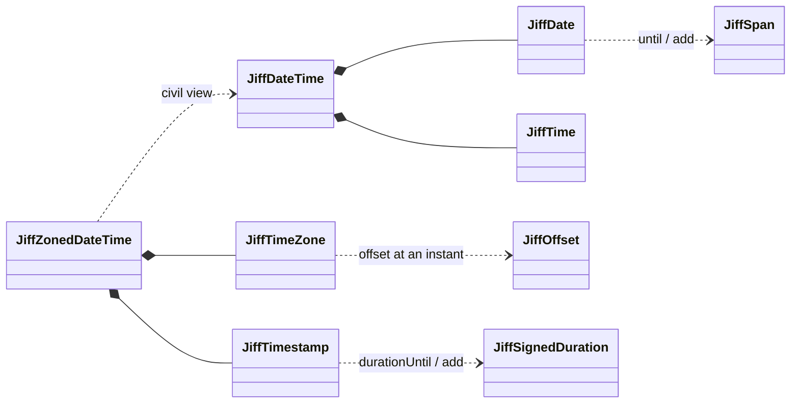

# jiff-force

A port of [Jiff](https://github.com/BurntSushi/jiff), Andrew Gallant's datetime library for Rust,
to Salesforce Apex.

Apex's `Date`, `Time` and `Datetime` cover the basics. They stop at milliseconds, mix up "a
calendar date" with "an instant", make daylight saving time arithmetic easy to get wrong, and have
no notion of a span such as "1 month and 3 days". Jiff's model fixes all of that, and jiff-force
brings the model to the platform:

- **Civil types** for what a calendar and a wall clock show: `JiffDate`, `JiffTime`,
  `JiffDateTime`.
- **Instants** with nanosecond precision: `JiffTimestamp`.
- **Zoned datetimes** that know their time zone and do DST-safe arithmetic: `JiffZonedDateTime`.
- **Spans** in calendar units (`JiffSpan`) and **absolute durations** (`JiffSignedDuration`),
  kept apart because "one day" and "24 hours" are not the same thing.
- **Rounding** of every type, with nine rounding modes and arbitrary increments.
- **Parsing and printing** in ISO 8601 / RFC 3339 / RFC 9557, ISO 8601 durations, a "friendly"
  duration format (`2h 30m`), `strftime`/`strptime`, and RFC 2822.

```apex
// Add a month to the last day of January: the day is clamped, not overflowed.
JiffDate.newInstance(2024, 1, 31).add(new JiffSpan().months(1));   // 2024-02-29

// What instant is 2:30 on the morning the clocks go forward in New York? There isn't one.
JiffTimeZone.get('America/New_York')
    .toAmbiguousTimestamp(JiffDateTime.newInstance(2024, 3, 10, 2, 30, 0, 0))
    .isAmbiguous();                                                // true (a gap)

// Durations parse from ISO 8601 or a friendly format, and print either way.
JiffSpan.parse('1 year, 2 months, 3 days').toString();             // P1Y2M3D
JiffSpan.parse('PT90M').toFriendly();                              // 90m

// A duration is exact elapsed time. Rounding has modes and increments.
JiffSignedDuration elapsed = JiffSignedDuration.fromMillis(5430500);
elapsed.round(JiffRound.to(JiffUnit.MINUTE).increment(15));        // PT1H30M

// A span keeps its units, and prints as an ISO 8601 duration.
new JiffSpan().years(1).months(2).days(3).hours(4).toString();     // P1Y2M3DT4H
```

## Status

This is a port in progress, tracking Jiff 1.0.0.

| Area | State |
| --- | --- |
| Units, rounding modes, rounding options | Done |
| `JiffSignedDuration` | Done |
| `JiffSpan` data model, ISO 8601 printing and parsing | Done |
| `JiffDate`, `JiffTime`: arithmetic, differences, rounding, builders, series | Done |
| `JiffIsoWeekDate`, `JiffWeekdays` | Done |
| `JiffTimestamp`, `JiffOffset` | Done |
| `JiffTimeZone` (platform backed), gap and fold resolution, transitions | Done |
| Friendly duration format (`2h 30m`, `1 year, 2 months ago`) | Done |
| `JiffDateTime` arithmetic, differences, rounding | In progress |
| ISO 8601 / RFC 9557 datetime parsing | In progress |
| `JiffZonedDateTime` | Planned |
| Span arithmetic, comparison, totals and rounding relative to a date | Planned |
| `strftime`/`strptime`, RFC 2822 | Planned |
| Converting Salesforce record fields to and from Jiff types | Partly done (dates, times, timestamps); zoned and a record helper planned |

## How it maps to Jiff

The API is Jiff's, translated by a few mechanical rules (the full list and the reasons are in
[ADR 1](docs/adr/0001-port-jiff-as-prefixed-apex-classes.md)):

| Jiff (Rust) | jiff-force (Apex) |
| --- | --- |
| `jiff::civil::Date`, `Time`, `DateTime` | `JiffDate`, `JiffTime`, `JiffDateTime` |
| `jiff::Timestamp`, `jiff::ZonedDateTime` | `JiffTimestamp`, `JiffZonedDateTime` |
| `jiff::Span`, `jiff::SignedDuration` | `JiffSpan`, `JiffSignedDuration` |
| `jiff::tz::TimeZone`, `jiff::tz::Offset` | `JiffTimeZone`, `JiffOffset` |
| `jiff::Unit`, `jiff::RoundMode`, `jiff::Error` | `JiffUnit`, `JiffRoundMode`, `JiffException` |
| `Date::new(2024, 2, 29)?` | `JiffDate.newInstance(2024, 2, 29)` |
| `d.checked_add(span)?` | `d.add(span)` (throws `JiffException`) |
| `"2024-02-29".parse::<Date>()?` | `JiffDate.parse('2024-02-29')` |
| `zdt.date()`, `zdt.time()` | `zdt.toDate()`, `zdt.toTime()` |
| `a < b`, `a == b` | `a.isBefore(b)` / `a.compareTo(b)`, `a.equals(b)` |
| `TimeRound`, `DateTimeRound`, ... | `JiffRound` |
| `DateDifference`, `TimeDifference`, ... | `JiffDifference` |

Every type is immutable. Every failure is a `JiffException`.



## Differences from Jiff

- **Time zone data comes from the platform**, not from a bundled copy of the IANA database
  ([ADR 3](docs/adr/0003-platform-backed-time-zones.md)). Offsets therefore always agree with
  `Datetime`, and follow the zone data Salesforce ships.
- **`JiffTimeZone.userTimeZone()`** (the running user's zone) replaces Jiff's system time zone.
- Methods that return `i128` in Jiff return `Long` here and throw if the value does not fit
  ([ADR 4](docs/adr/0004-nanoseconds-without-128-bit-integers.md)).
- Jiff's fallible/panicking method pairs collapse into one method that throws.

## Installing

Deploy the classes in `force-app` with the Salesforce CLI:

```bash
sf project deploy start --source-dir force-app --target-org <your-org>
```

The library has no dependencies, uses no SOQL or DML, and declares no custom metadata.

## Developing

```bash
npm install
```

```bash
npm test
```

```bash
npm run test:aer -- -f JiffDateTest
```

- `npm test` translates the Apex to Java and runs every test on the JVM in about a second.
- `npm run test:aer` runs tests on [AER](https://github.com/octoberswimmer/aer-dist), a local
  Apex runtime (install it separately). Its free tier runs up to 100 test methods at a time; set
  `AER_LICENSE_KEY` to run the whole suite.
- `npm run fmt` formats with Salesforce's Apex parser; `npm run test:coverage` enforces the
  coverage gate; `npm run oracle` regenerates the golden vectors from the real Jiff crate
  (requires Rust).

Why there are two runners, and what each one catches, is explained in
[ADR 2](docs/adr/0002-local-test-runners.md). Conventions for contributors (the Apex subset the
library is written in, naming rules, testing rules) are in [CLAUDE.md](CLAUDE.md).

## Licence

Apache-2.0. Jiff itself is dual licensed under MIT and the Unlicense; this port is a derived work
of its design and algorithms.
