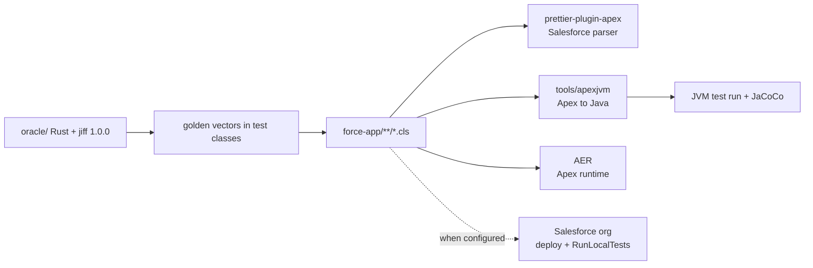

# 2. Test locally with two independent Apex runners

Date: 2026-11-17

## Status

Accepted

## Context

Apex normally compiles and runs only inside a Salesforce org. A deploy-and-poll loop is slow, and
the environment this library is developed in has no org attached at all. A datetime library is
almost entirely pure computation with a very large space of edge cases, so it needs a fast,
exhaustive red/green loop and differential testing against the Rust original. Shipping thousands
of lines of arithmetic that have never been executed is not acceptable.

Two ways of running Apex without an org are available:

1. **AER** (<https://github.com/octoberswimmer/aer-dist>), a third party Apex runtime with its own
   parser, type checker, standard library and coverage. It is the closest thing to the platform
   that runs locally. It is proprietary: its free tier runs at most 100 test methods per
   invocation, and a larger run needs a licence key.
2. **A translation harness** (`tools/apexjvm`) written for this project. It translates a
   disciplined subset of Apex to Java, line for line, compiles it against small shims for the
   platform types the library uses, and runs the `@IsTest` methods on the JVM, each in a fresh
   class loader so static state resets as it does between Apex transactions.

Neither is the platform. Each has blind spots:

- The harness only knows the Apex semantics someone encoded in it. It let a reserved word
  (`limit`) and Java-only assumptions through until other tools flagged them.
- AER 1.7.3 evaluates `<`, `>`, `<=`, `>=` on `Long` values through a 64 bit float, so two values
  above 2^53 that differ slightly compare as equal. Ten tests that passed on the harness failed
  on AER for this reason alone. Whether the platform shares that behaviour is unverified.

## Decision

Use both, and require both to pass.

- `npm test` (the harness) is the full-suite gate: unlimited, about a second, and strict (it
  rejects anything outside the subset rather than guessing).
- `aer test force-app` is the fidelity check. Without a licence key it is run per test class
  (`-f JiffDateTest`); with `AER_LICENSE_KEY` set it runs the whole suite. The 100 test limit is
  a licence term and is not scripted around.
- `prettier-plugin-apex` runs Salesforce's own parser, and is the syntax gate.
- Code is written so that it is correct under the semantics of *every* runner. Where they
  disagree, the library avoids the construct rather than picking a side: large `Long` values are
  compared with `JiffMath.compare`, which is exact everywhere, and nothing relies on integer
  wrap-around.
- CI runs the harness with coverage on every push, runs AER when `AER_LICENSE_KEY` is configured,
  and validates against a real org when `SFDX_AUTH_URL` is configured.

## Consequences

- Two independent implementations of Apex semantics agreeing is much stronger evidence than
  either alone, and a disagreement points straight at a portability hazard.
- The library is confined to the harness's subset (documented in `CLAUDE.md`): no nullable
  primitives without spelling `System.Integer`, no properties, no `Decimal`, a whitelist of system
  methods. The subset is also simply safer Apex.
- The harness is project-owned tooling that must be maintained. If AER (with a licence) proves
  sufficient on its own, the harness can be retired without touching the library.
- A real org is still the final authority. Nothing here proves the code compiles on the
  platform; the optional CI job does.
